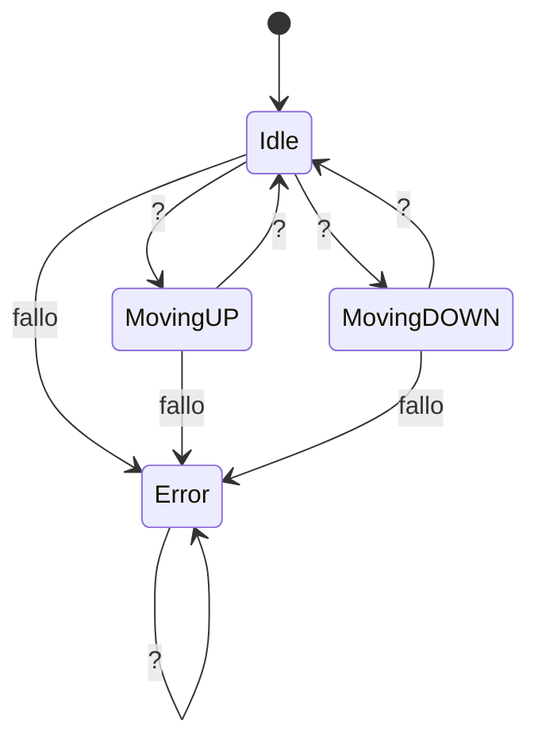

# Examen Máquina de Estados

---

## PMDM
## Gabriela Martinez Menegatty

---

## Diagrama de estados

### Tipo de variables

Se utilizaron Variables de tipo entero para los niveles y de tipo booleano para los botones de control. La variable `nivel_actual` se inicializa a 0, representando el nivel Avenida G. Barbón. Los botones `nivel_0` y `nivel_1` son de tipo booleano, 
indicando si se desea ir al nivel correspondiente.

### Estados

Los estados se dividieron entre `Object` y `Data class`. Cada estado tiene funciones 
específicas para manejar las acciones del ascensor.

- **Idle**: Estado inicial, donde el ascensor está detenido en un nivel.
- **MovingUP**: Estado en el que el ascensor se mueve hacia arriba.
- **MovingDOWN**: Estado en el que el ascensor se mueve hacia abajo.
- **Error**: Estado en el que el ascensor ha experimentado un fallo.
    
### Transiciones

### Test 

### Documentación 

